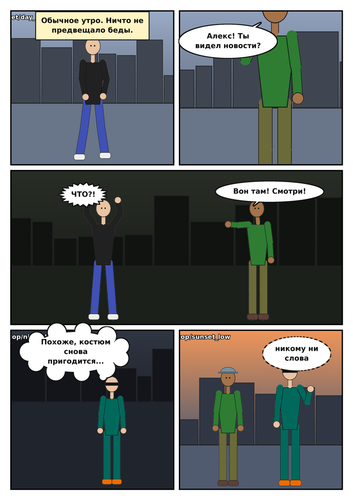

# Comix Project: генератор страниц комикса

Пайплайн собирает страницу комикса на 3–5 кадров:

1. **Персонажи**: пол, цвет кожи, внешность и одежда по слотам (голова, верх, низ, обувь). Генерируются через **Flux** или **Z-Image** в ComfyUI.
2. **5 универсальных поз**: `idle` (стоит), `talk` (говорит), `point` (указывает), `walk` (идёт), `shock` (удивлён). Для каждой есть скелет OpenPose, через ControlNet он даёт одну и ту же позу при любой одежде.
3. **Фоны** через **Qwen-Image**: 5 локаций × 5 вариаций (ракурс, время суток), чтобы кадры отличались.
4. **Облачки**: реплика, мысли, крик, шёпот, подпись. Рисуются кодом, а не нейросетью: контур ровный, размер подстраивается под текст, хвостик смотрит на говорящего.
5. **Компоновщик**: собирает страницу по сценарию в YAML.

Пока картинок нет, вместо них подставляются черновики (фигурки в цветах одежды). Так можно отладить сценарий и раскладку ещё до генерации.



## Установка

```bat
cd /d D:\VibeProjects
git clone -b claude/project-thread-qry7qr https://github.com/aleasdeck/Comix-Project "Comix Project"
cd "Comix Project"
py -3 -m pip install -r requirements.txt
rem по желанию, для качественного удаления фона у персонажей:
py -3 -m pip install rembg
```

Дальше все команды запускаются через `comix.bat` (это то же, что `py -3 -m comix`).

### Генератор: ImageGen

По умолчанию картинки делает локальный **ImageGen** (`D:\VibeProjects\ImageGen`, путь задаётся в `config/settings.yaml` → `imagegen.path`). Comix вызывает его `jobs.generate(items=...)` одной пачкой на модель, ждёт PNG, вырезает персонажей из фона и раскладывает файлы по `assets/`. ComfyUI ImageGen поднимает и закрывает сам.

| Что | Пресет ImageGen | Настройка |
|---|---|---|
| Персонажи | `klein` (FLUX.2 klein 4B), можно `zimage` | `imagegen.character_model` |
| Фоны | `qwen` (Qwen-Image-2512), можно `qwen-fast` | `imagegen.background_model` |

Сначала генерируются все персонажи, потом все фоны: при переходе на Qwen ImageGen перезапускает ComfyUI, поэтому смешивать их нельзя. После пачки ComfyUI закрывается, когда опустеет очередь (`imagegen.stop_after`).

В ImageGen нет ControlNet, поэтому поза задаётся только текстом промпта. Скелеты OpenPose из `assets/poses` пригодятся, если позы будут «плыть»: их можно подключить через `backend: comfyui` и шаблоны из `workflows/` (это запасной путь напрямую в ComfyUI, для него нужна модель ControlNet).

## Команды

```bash
python -m comix ping                         # видит ли ImageGen и есть ли нужные модели
python -m comix wardrobe                     # каталог одежды
python -m comix character list
python -m comix character new                # создать персонажа, спросит всё по шагам
python -m comix character new --id kate --gender female --skin dark \
    --hair "short white hair" --outfit head=fedora top=trench_coat bottom=black_trousers shoes=boots

python -m comix poses                        # скелеты OpenPose и превью поз -> assets/poses
python -m comix bubbles                      # набор PNG облачков -> assets/bubbles

python -m comix gen characters --char alex                  # alex во всех 5 позах
python -m comix gen characters --char alex --outfit head=fedora top=trench_coat
python -m comix gen backgrounds --location street           # все вариации улицы
python -m comix gen page scripts/example_page.yaml          # только то, чего не хватает странице

python -m comix page scripts/example_page.yaml              # собрать страницу -> output/
```

У любой `gen` есть `--dry-run`: ничего не генерируется, а промпты, сиды и размеры, которые ушли бы в ImageGen, сохраняются в `build/dry_run/*.json`. `--force` перегенерирует уже готовое.

## Как устроено

```
config/
  settings.yaml      адрес ComfyUI, модели, размеры, стиль, шрифт
  characters.yaml    персонажи и оттенки кожи
  wardrobe.yaml      одежда по слотам head / top / bottom / shoes
  backgrounds.yaml   локации и вариации фонов
workflows/           шаблоны ComfyUI (формат API) с плейсхолдерами {{...}}
scripts/             сценарии страниц
comix/               код
assets/
  characters/<id>/<голова-верх-низ-обувь>/<поза>.png   вырезанный персонаж (PNG с прозрачностью)
  backgrounds/<локация>/<вариация>.png
  poses/, bubbles/
```

**Смена одежды.** Каждая картинка персонажа хранится по ключу наряда. В сценарии у любого персонажа в любом кадре можно заменить отдельные слоты (`outfit: {head: hero_mask}`), и `gen page` догенерирует именно эту комбинацию.

**Похожесть лица.** У персонажа фиксированный `seed`, он один для всех поз и нарядов. Для полной стабильности лица следующим шагом можно добавить LoRA персонажа или PuLID / IP-Adapter в воркфлоу.

**Свой воркфлоу (только `backend: comfyui`).** Собери граф в ComfyUI, включи Dev mode, сделай *Export (API)* и замени нужные значения плейсхолдерами: `{{POSITIVE}}`, `{{NEGATIVE}}`, `{{SEED}}`, `{{WIDTH}}`, `{{HEIGHT}}`, `{{STEPS}}`, `{{CFG}}`, `{{GUIDANCE}}`, `{{UNET}}`, `{{CLIP}}`, `{{CLIP_T5}}`, `{{CLIP_L}}`, `{{VAE}}`, `{{CONTROLNET}}`, `{{POSE_IMAGE}}`, `{{PREFIX}}`. Потом пропиши путь к нему в `settings.yaml` → `workflows`.

## Сценарий страницы

См. `scripts/example_page.yaml`. Раскладки: `3a 3b 3c 4a 4b 4c 5a 5b` или `auto`.

```yaml
layout: 4b
panels:
  - background: street/day_wide
    characters:
      - {id: alex, pose: walk, x: 0.5, y: 0.97, height: 0.8}
    bubbles:
      - {kind: speech, text: "Привет!", x: 0.3, y: 0.15, tail_to: alex}
```

Координаты задаются в долях кадра (0..1): `x` — центр персонажа, `y` — линия ступней, `height` — рост относительно высоты кадра (больше 1 даёт крупный план). Для облачка `x`, `y` — его центр, `tail_to` — id персонажа или точка `[x, y]`.

Для кириллицы в облачках нужен шрифт с кириллицей. Список кандидатов задаётся в `settings.yaml` → `fonts.bubble`, первым проверяется `assets/fonts/bubble.ttf`.
